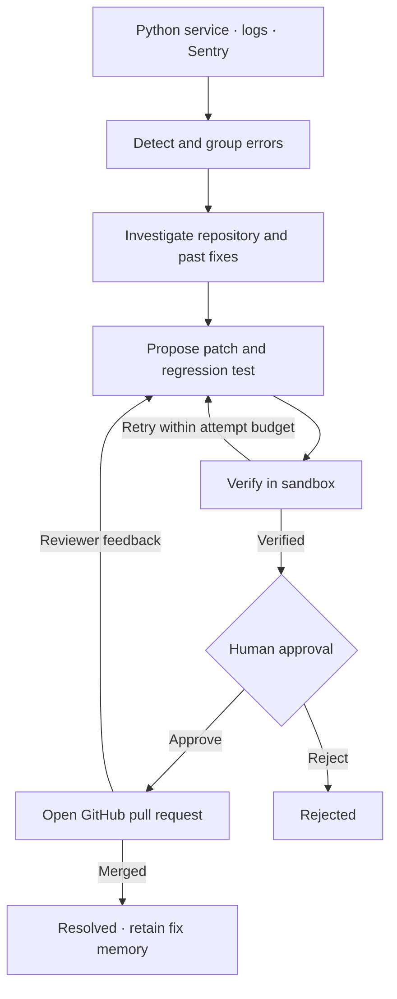

<div align="center">

# 🛠️ AgentOps AI

### An AI engineering workspace that turns Python errors into reviewable fixes

**Detect → Investigate → Fix → Verify → Human approval → Pull request**

Powered by **NVIDIA Nemotron 3** on **Nebius Token Factory**

[](#-step-by-step-setup)
[](#-api-reference)
[](#-how-it-works)
[](#-how-it-works)

[](#-step-11--run-the-test-suite)
[](#-recorded-live-runs)
[](#-recorded-live-runs)
[](#-recorded-live-runs)
[](LICENSE)

*Built for the **Nebius × NVIDIA Global AI Hackathon 2026**, Coding & Agentic Engineering track*

[What it does](#-what-it-does) •
[Live runs](#-recorded-live-runs) •
[How it works](#-how-it-works) •
[Setup](#-step-by-step-setup) •
[Integrations](#-step-7--connect-github-webhooks-review-loop) •
[API](#-api-reference) •
[Troubleshooting](#-troubleshooting)

</div>

---

## 💡 The problem

At 3 a.m. production throws a `KeyError`. Before anyone writes a fix, an engineer has to:
- dig through logs
- find the right file
- reproduce the bug
- write a fix and a test
- run the suite
- open a PR

AgentOps AI automates this investigation and verification loop, then presents the evidence in one workspace. A human decides whether to open the pull request. Runtime and fix quality depend on the repository, tests, model, and available tools.

---

## 🖥️ The workspace

| View | What you can do |
|---|---|
| **Incident overview** | Filter the inbox, see active investigations, and find fixes waiting for approval |
| **Incident detail** | Inspect the diagnosis, code diff, regression tests, test evidence, and audit trail |
| **Repositories** | Register Python repositories and track clone and dependency setup |
| **Activity & metrics** | Follow agent actions, outcomes, timings, and token use |
| **Integrations** | Configure GitHub, Sentry, and notification connections |
| **Team & settings** | Manage roles, sessions, API connection, and local preferences |

## ✨ What it does

| | Step | What happens |
|:-:|---|---|
| 🔍 | **Detect** | Reads errors from your logs, the drop-in Python handler, or **Sentry**. Groups repeats and sets severity |
| 🧠 | **Investigate** | Nemotron explores the **real repository** with tools (read files, search code, git log, web search) and names the root cause with evidence |
| 🩹 | **Fix** | Writes a minimal patch **plus a new regression test** that reproduces the bug |
| 🧪 | **Verify** | Runs **your own pytest suite** in a sandbox (Docker or subprocess). The new test must **fail before** the fix and **pass after** it, with **zero regressions** |
| 🙋 | **Approve** | A named human reviews the diagnosis, diff and test evidence, then approves or rejects |
| 🚀 | **Ship** | Opens a **GitHub Pull Request** with the full write-up |
| 🔁 | **Revise** | A reviewer comments `/agentops <instructions>` or requests changes, and AgentOps updates the PR |
| 📈 | **Learn** | Merged fixes become memory, and a returning error is flagged as a **regression** |
| 📣 | **Alert** | Sends Slack, email or webhook notifications at every key step |

> 🔒 **AgentOps never merges, never pushes to your existing branches, and never gives the model a shell.**

---

## 🎬 Recorded live runs

The project author reports the following runs using NVIDIA Nemotron, [`agentops-test-shop`](https://github.com/yasmeenmh90-beep/agentops-test-shop), and connected services. These are historical demonstrations; the current backend review uses local tests and mocked external APIs and does not re-verify the live claims below:

| Live test | Result |
|---|:-:|
| 🐛 Real bugs diagnosed, fixed and opened as PRs **#1–#4**, each on the **first attempt** | ✅ |
| 🧪 Model-written regression tests: on PR #5, **2 new tests failed on the buggy code and passed after the fix**, with 0 regressions | ✅ |
| 🔁 `/agentops` review comment on PR #4: fix revised, commit pushed to the PR branch, results posted back | ✅ |
| 🚨 **Sentry → AgentOps → PR**. The error was captured by `sentry-sdk`, sent through a signed webhook (`200 OK`), verified, approved, and opened as **[PR #5](https://github.com/yasmeenmh90-beep/agentops-test-shop/pull/5)** | ✅ |
| 🐳 Docker sandbox (`--network none`): fix verified with `runner: docker` | ✅ |
| 📧 Email alerts (Gmail SMTP): "incident opened" and "fix ready" emails delivered | ✅ |

---

## 🧭 How it works



### 🔄 Incident lifecycle

```
DETECTED ➜ INVESTIGATING ➜ FIXING ➜ TESTING ➜ AWAITING_APPROVAL ➜ PR_CREATED ➜ RESOLVED
                                                                    ⇅
                                                                REVISING
Side exits:  REJECTED · PR_CLOSED · NEEDS_HUMAN (no verified fix after 3 tries) · FAILED (can be re-run)
```

### 🤖 The agents

| Agent | Powered by | Responsibility |
|---|---|---|
| **Detector** | Rule-based parser + Nemotron 3 Nano (summary) | Parses Python tracebacks, maps frames to repo files, groups by `exception + file:function`, sets severity, detects regressions |
| **Investigator** | Nemotron 3 Ultra (tool calling) | Uses `list_files` · `read_file` · `search_code` · `git_log` · `web_search` and finishes with `submit_root_cause` |
| **Fixer** | Nemotron 3 Ultra (tool calling) | Writes exact search/replace edits and a regression test, then calls `submit_patch`. AgentOps builds the diff itself |
| **Tester** | pytest + JUnit XML | Runs the suite before and after the patch in a sandbox |
| **Approval gate** | A human | Approve → PR, or reject with a reason |

### ✅ The verification rule

A fix counts as **verified** only when all of these hold:

1. The new regression test **fails on the original code**. This proves it reproduces the bug.
2. It **passes on the patched code**.
3. **No test** that passed before now fails.
4. Every previously completed test still completes after the patch. Skipped or missing tests cannot be counted as fixed.
5. Both test runs complete without collection errors or unsuccessful runner exit codes.

---

## 🔐 Safety by design

| Guardrail | How it's enforced |
|---|---|
| 🙋 Human in the loop | No auto-merge. A PR only opens after a named approver says yes. Double approvals are blocked |
| 🚫 No shell for the model | The model can only read files and propose edits |
| 📦 Sandboxed tests | **Docker:** `--network none` with CPU, memory and pid limits. **Subprocess:** scrubbed env (no keys), with a timeout |
| ✂️ Bounded patches | `.py` only, ≤ 40 lines of app code and ≤ 120 lines of test. Existing tests can't be edited. CI, Dockerfile, dependency files, `conftest.py` and migrations are protected |
| 📁 Path confinement | Path traversal and absolute paths are rejected |
| 🧱 Prompt-injection hygiene | Logs, file contents, web results and review comments are wrapped as `<untrusted_*>` data |
| ✍️ Signed webhooks | HMAC-SHA256 for GitHub and Sentry. Revisions only for `OWNER`, `MEMBER` or `COLLABORATOR` |
| 📜 Budgets and audit | Per-incident token budget, tool-round cap, and an audit log of every tool call and decision |
| 🔑 Secrets | Tokens are read from env vars, passed to git per command and masked in errors |

---

## 🚀 Step-by-step setup

> Follow the steps in order. Steps 1–6 give you the full pipeline. Steps 7–10 add the live integrations.

### ✅ Step 0 — Prerequisites

| You need | Check with |
|---|---|
| Python **3.11+** | `python3 --version` |
| git | `git --version` |
| Node.js **20+** and npm (dashboard) | `node --version` / `npm --version` |
| Docker *(optional, for the Docker sandbox)* | `docker --version` |
| A GitHub account and a Python repo **with a pytest suite** | — |

### 🔑 Step 1 — Get your keys

| Key | Where to get it | Required? |
|---|---|:-:|
| `NEBIUS_API_KEY` | [Nebius Token Factory](https://tokenfactory.nebius.com) → **API keys** → *Create key* | ✅ |
| `GITHUB_TOKEN` | GitHub → **Settings → Developer settings → Personal access tokens**. Classic token: tick only **`repo`**. Fine-grained token: **Contents: Read & write** and **Pull requests: Read & write**, limited to your repo | ✅ |
| `API_KEYS` | Any long random string you choose (clients send it as `X-API-Key`). Generate one with `openssl rand -hex 24` | ✅ |
| `TAVILY_API_KEY` | [tavily.com](https://tavily.com) → dashboard | Optional |

> ⚠️ Never commit keys. `.env` is already in `.gitignore`. This package includes a blank `.env.example` and excludes runtime credentials, databases, and logs. If you used credentials from an older shared example, rotate them before deployment.

### 📥 Step 2 — Install

```bash
git clone https://github.com/yasmeenmh90-beep/NIVIDA-agentops-ai.git
cd NIVIDA-agentops-ai/backend
python3 -m venv .venv
source .venv/bin/activate
pip install -r requirements.txt
```

On Windows, activate with `.venv\Scripts\activate` instead.

### ⚙️ Step 3 — Configure `.env`

```bash
cp .env.example .env
```

Open `.env` and fill in at least:

```env
NEBIUS_API_KEY=your-nebius-key
API_KEYS=your-random-api-key
GITHUB_TOKEN=your-github-token
TAVILY_API_KEY=optional
```

These are the model IDs configured in this source version. They are case-sensitive; confirm availability with `scripts/check_nebius.py`:

```env
MODEL_REASONING=nvidia/Nemotron-3-Ultra-550b-a55b
MODEL_TRIAGE=nvidia/NVIDIA-Nemotron-3-Nano-30B-A3B
```

<details>
<summary><b>📋 All environment variables</b></summary>

| Variable | Default | Purpose |
|---|---|---|
| `NEBIUS_API_KEY` | — | Nebius Token Factory key |
| `NEBIUS_BASE_URL` | `https://api.tokenfactory.nebius.com/v1/` | OpenAI-compatible endpoint |
| `MODEL_REASONING` / `MODEL_TRIAGE` | Nemotron 3 Ultra / Nano | Models used |
| `API_KEYS` | — | Comma-separated service keys. With no keys and no users, local open mode is enabled; creating the first user enables sign-in |
| `GITHUB_TOKEN` | — | Clone private repos and open PRs |
| `TAVILY_API_KEY` | — | Web search for the Investigator |
| `SANDBOX_MODE` | `auto` | `auto` · `docker` · `subprocess` |
| `MAX_FIX_ATTEMPTS` | `3` | Fixer retries before `NEEDS_HUMAN` |
| `MAX_PATCH_LINES` / `MAX_TEST_LINES` | `40` / `120` | Patch size limits |
| `REQUIRE_REGRESSION_TEST` | `true` | A fix must ship a test that fails before and passes after |
| `MAX_REVISIONS` | `3` | Reviewer-requested revisions per PR |
| `MAX_TOKENS_PER_INCIDENT` | `400000` | Token budget |
| `GITHUB_WEBHOOK_SECRET` | — | Verifies GitHub webhooks |
| `REVISION_AUTHOR_ASSOCIATIONS` | `OWNER,MEMBER,COLLABORATOR` | Who can trigger revisions |
| `SENTRY_CLIENT_SECRET` | — | Verifies Sentry webhooks |
| `PUBLIC_BASE_URL` | — | Links in notifications |
| `SLACK_WEBHOOK_URL` / `NOTIFY_WEBHOOK_URL` | — | Alerts |
| `SMTP_HOST` `SMTP_PORT` `SMTP_USER` `SMTP_PASSWORD` `SMTP_FROM` `NOTIFY_EMAIL_TO` | port `587` | Email alerts |
| `NOTIFY_MIN_SEVERITY` | `medium` | Minimum severity for "new incident" alerts |
| `DATABASE_URL` | SQLite in `backend/` | Use Postgres in production |
| `CORS_ORIGINS` | `http://localhost:5173` | Dashboard origin(s) |
| `WORKSPACE_DIR` | `backend/workspace` | Where repos and venvs are cloned |
| `FRONTEND_URL` | `http://localhost:5173` | Dashboard URL, also used by GitHub OAuth callbacks |
| `SIGNUP_MODE` / `DEFAULT_ROLE` | `open` / `viewer` | First account is admin; later accounts follow the signup policy |
| `SESSION_DAYS` | `14` | Session lifetime |
| `GITHUB_OAUTH_CLIENT_ID` / `GITHUB_OAUTH_CLIENT_SECRET` | — | Optional GitHub dashboard sign-in |

</details>

### 🩺 Step 4 — Check the Nemotron connection

```bash
python scripts/check_nebius.py
```

✅ You should see the Nemotron models listed and a successful tool-calling test. A `401` means the key is wrong, and a `404` means a model ID is mistyped.

### ▶️ Step 5 — Start the server

```bash
uvicorn app.main:app --host 0.0.0.0 --port 8000
```

Then, in a second terminal:

```bash
export KEY=your-random-api-key
curl -s localhost:8000/health
curl -s -H "X-API-Key: $KEY" localhost:8000/status
```

✅ `/health` returns `{"status":"ok"}`, and `/status` shows which integrations are configured. Interactive API docs are at **http://localhost:8000/docs**.

### 🖥️ Step 5A — Start the dashboard

Open another terminal from the project root:

```bash
cd frontend
cp .env.example .env
npm ci
npm run dev
```

Leave `VITE_AGENTOPS_KEY` blank for shared deployments and sign in through the dashboard; Vite environment values are included in the client bundle.

Open **http://localhost:5173**. The default API URL is **http://localhost:8000**; set `VITE_API_URL` in `frontend/.env` when the backend runs elsewhere. Restart Vite after changing environment variables.

The dashboard uses a charcoal and emerald design with responsive navigation, a workflow overview, status cards, and a filterable incident inbox. The frontend production build is checked separately from backend tests; browser visual verification has not been completed in this environment.

**Sign-in choices:**

- Use a service API key for a local demo, or create the first user account to become admin.
- New accounts default to **viewer**. An admin can grant **member** access for approvals and repository changes.
- Set `SIGNUP_MODE=closed` to block additional self-service registrations after the first account.
- For GitHub sign-in, create an OAuth App with callback `<backend-url>/auth/github/callback`, then set the OAuth client ID, secret, and `FRONTEND_URL`. A verified GitHub email is required.
- Set `CORS_ORIGINS` to the exact dashboard origin. Use HTTPS for a deployed frontend and backend.

Build the dashboard for deployment:

```bash
cd frontend
npm run build
```

Serve `frontend/dist` with SPA fallback to `index.html` so direct links to incident pages work.

### 📂 Step 6 — Register a repo and fix your first bug

**6.1 Register the repository.** AgentOps clones it and installs its dependencies into its own virtualenv:

```bash
curl -s -X POST localhost:8000/projects -H "X-API-Key: $KEY" -H "Content-Type: application/json" -d '{
  "name": "shop",
  "repo_url": "https://github.com/your-user/your-repo.git",
  "default_branch": "main",
  "test_command": "python -m pytest -q"
}'
```

**6.2 Wait for setup to finish:**

```bash
curl -s -H "X-API-Key: $KEY" localhost:8000/projects/shop
```

✅ Wait until `"setup_status": "ready"`.

**6.3 Send an error.** Use any of these three ways:

<details open>
<summary><b>A. Drop-in Python handler</b> (recommended for real apps)</summary>

Copy `clients/python/agentops_handler.py` into your service. It uses the standard library only:

```python
import agentops_handler
agentops_handler.install(url="http://localhost:8000", api_key="your-api-key",
                         project="shop", service="shop-api")
```

It captures `logger.exception(...)` and uncaught exceptions. It also de-duplicates bursts and sends in the background, so it never blocks your app.
</details>

<details>
<summary><b>B. Raw log lines</b></summary>

```bash
curl -s -X POST localhost:8000/ingest/logs -H "X-API-Key: $KEY" -H "Content-Type: application/json" \
  -d '{"project": "shop", "source": "prod-1", "lines": ["Traceback (most recent call last):", "  File \"/app/orders/pricing.py\", line 12, in discount_rate", "    ...", "KeyError: '\''VIP'\''"]}'
```
</details>

<details>
<summary><b>C. Upload a log file</b></summary>

```bash
curl -s -X POST localhost:8000/ingest/file -H "X-API-Key: $KEY" -F project=shop -F file=@app.log
```
</details>

**6.4 Watch the agents work:**

```bash
curl -s -H "X-API-Key: $KEY" "localhost:8000/incidents?project=shop"
curl -s -H "X-API-Key: $KEY" localhost:8000/incidents/1
```

The status moves `DETECTED → INVESTIGATING → FIXING → TESTING → AWAITING_APPROVAL`. The detail view shows:
- the root cause
- the diff
- the regression test
- the before and after test results
- every agent step and the audit trail

**6.5 Approve.** This opens the GitHub PR:

```bash
curl -s -X POST localhost:8000/incidents/1/approve -H "X-API-Key: $KEY" -H "Content-Type: application/json" \
  -d '{"approver": "yasmeen", "note": "Verified fix"}'
```

✅ Returns `{"ok": true, "pr_url": "https://github.com/.../pull/N"}`.

To reject instead:

```bash
curl -s -X POST localhost:8000/incidents/1/reject -H "X-API-Key: $KEY" -H "Content-Type: application/json" \
  -d '{"approver": "yasmeen", "reason": "fix belongs in the validator"}'
```

> 🎉 **That's the core pipeline.** The next steps add the live integrations.

---

### 🐙 Step 7 — Connect GitHub webhooks (review loop)

This lets AgentOps react when a PR is merged, closed, or gets review feedback.

**7.1 Expose your local server.** Skip this if you have deployed:

```bash
cloudflared tunnel --url http://localhost:8000
```

Copy the `https://xxxx.trycloudflare.com` URL it prints.

> ⚠️ A quick-tunnel URL changes every time you restart it. When it does, update the webhook URLs.

**7.2 Create a secret, add it to `.env`, then restart the server:**

```bash
openssl rand -hex 24
```

```env
GITHUB_WEBHOOK_SECRET=the-value-you-generated
```

**7.3 In your repo, go to Settings → Webhooks → Add webhook:**

| Field | Value |
|---|---|
| Payload URL | `https://<your-host>/webhooks/github` |
| Content type | `application/json` |
| Secret | the same `GITHUB_WEBHOOK_SECRET` |
| Events | ☑️ Pull requests · ☑️ Pull request reviews · ☑️ Issue comments |

**7.4 Try it.** On an AgentOps PR, comment:

```
/agentops remove the unused import
```

✅ AgentOps revises the fix, re-verifies it, pushes a commit to the PR branch and replies with the results.

| PR event | Result |
|---|---|
| Merged | Incident becomes `RESOLVED`, and the fix is added to memory |
| Closed without merge | `PR_CLOSED` |
| `/agentops …` comment or *Request changes* review | `REVISING`, then a new commit on the PR |

---

### 🚨 Step 8 — Connect Sentry

**8.1** In Sentry, go to **Settings → Developer Settings → Custom Integrations → Create New Integration → Internal Integration** and fill in:

| Field | Value |
|---|---|
| Name | `AgentOps` |
| Webhook URL | `https://<your-host>/webhooks/sentry/<project-name>` (e.g. `/webhooks/sentry/shop`) |
| Alert Rule Action | **ON** |
| Permissions → Issue & Event | **Read** |

**8.2** Save, then copy the **Client Secret** from the *Credentials* section into `.env` and restart the server:

```env
SENTRY_CLIENT_SECRET=your-client-secret
```

**8.3** Create the alert. Go to **Alerts → Create Alert → Issues** and set:
- **WHEN:** *A new issue is created*
- **THEN:** *Send a notification via AgentOps*

**8.4** Test it from your app:

```python
import sentry_sdk
sentry_sdk.init(dsn="your-sentry-dsn")
try:
    1 / 0
except Exception as e:
    sentry_sdk.capture_exception(e)
sentry_sdk.flush()
```

✅ Sentry sends a signed webhook and AgentOps opens an incident from the stack trace.

---

### 📧 Step 9 — Email, Slack and webhook alerts

**Gmail example.** Create an *App Password* first (Google Account → Security → 2-Step Verification → App passwords):

```env
SMTP_HOST=smtp.gmail.com
SMTP_PORT=587
SMTP_USER=you@gmail.com
SMTP_PASSWORD=your-16-char-app-password
SMTP_FROM=you@gmail.com
NOTIFY_EMAIL_TO=you@gmail.com,teammate@example.com
```

**Slack and generic webhook:**

```env
SLACK_WEBHOOK_URL=https://hooks.slack.com/services/...
NOTIFY_WEBHOOK_URL=https://your-endpoint.example.com/agentops
```

📣 Events that trigger alerts:
- incident opened
- fix ready for approval
- needs human
- pipeline error
- PR opened
- PR revised
- revision failed
- resolved

---

### 🐳 Step 10 — Docker sandbox (optional, stronger isolation)

Tests run with `--network none`, so you need to bake the project's dependencies into an image.

**Build the image** from the AgentOps repo root:

```bash
docker build -f sandbox/Dockerfile --build-arg REQUIREMENTS=path/to/your/requirements.txt -t agentops-sbx-shop .
```

**Switch the project to Docker:**

```bash
curl -s -X PATCH localhost:8000/projects/shop -H "X-API-Key: $KEY" -H "Content-Type: application/json" \
  -d '{"sandbox_mode": "docker", "sandbox_image": "agentops-sbx-shop"}'
```

✅ The next verification shows `runner: docker` in the test results.

---

### 🧪 Step 11 — Run the test suite

```bash
cd backend && python -m pytest -q
```

The final source contains **70 tests**. Validation passed the 69-test full suite and a separate additional OAuth regression check. The suite covers unit behavior, backend regressions, accounts and roles, signed webhooks, and a local HTTP pipeline. Run it from `backend/` so `pytest.ini` excludes deliberately buggy fixture services. See [backend review](docs/BACKEND_REVIEW.md) for this revision’s validation results and limits.

The end-to-end tests run AgentOps as a **real HTTP server** against a **real git repo**. They cover the full loop:
1. exception
2. verified fix
3. approval
4. PR
5. signed "changes requested" review
6. revision commit
7. merge
8. `RESOLVED`
9. regression detection when the error returns

Only the LLM (scripted) and the GitHub and Slack APIs (mocked) are replaced. The historical [live runs](#-recorded-live-runs) are separate from these automated checks.

---

## 📡 API reference

Protected endpoints accept `X-API-Key` or `Authorization: Bearer <session-token>`. Viewers can read; members can perform incident and repository actions; admins can also manage users. `/health` and the sign-in endpoints are public. Webhooks require a signature; Sentry also accepts an explicit valid API credential. SSE endpoints accept `?api_key=` for EventSource compatibility.

| Method | Endpoint | Purpose |
|---|---|---|
| `POST` `GET` | `/projects` | Register or list repositories |
| `GET` `PATCH` `DELETE` | `/projects/{name}` | Detail, update or delete |
| `POST` | `/projects/{name}/setup` | Re-sync and reinstall dependencies |
| `POST` | `/ingest/logs` | `{project, source, lines[]}` |
| `POST` | `/ingest/events` | `{project, source, events[]}` |
| `POST` | `/ingest/file` | multipart: `project`, `file` |
| `GET` | `/incidents?project=&status=` | List incidents |
| `GET` | `/incidents/{id}` | Full detail: steps, patches, decisions, audit |
| `GET` | `/incidents/stream` · `/incidents/{id}/stream` | Live updates via SSE (`?api_key=` allowed) |
| `POST` | `/incidents/{id}/approve` | Approve and open a PR |
| `POST` | `/incidents/{id}/reject` | Reject with a reason |
| `POST` | `/incidents/{id}/run` | Re-run a `FAILED` or `NEEDS_HUMAN` incident |
| `GET` | `/metrics?project=` | Fix rate, first-attempt rate, time to fix/PR/merge, tokens |
| `POST` | `/webhooks/github` | GitHub events (HMAC) |
| `POST` | `/webhooks/sentry/{project}` | Sentry events (HMAC) |
| `GET` | `/status` · `/health` | Integrations configured · liveness |
| `GET` | `/activity` | Audit activity across incidents |
| `POST` | `/incidents/{id}/revise` · `/incidents/{id}/cancel` | Request a revision or stop an active run |
| `GET` | `/auth/config` · `/auth/me` | Sign-in options · current identity |
| `POST` | `/auth/signup` · `/auth/login` · `/auth/logout` | Account sessions |
| `GET` | `/auth/github/start` · `/auth/github/callback` | GitHub OAuth sign-in |
| `GET` | `/users` | List users (admin) |
| `PATCH` `DELETE` | `/users/{id}` | Change role or delete account (admin) |

📘 **Building the dashboard?** See **[docs/API.md](docs/API.md)** for real response shapes, the lifecycle and SSE usage.

---

## ☁️ Deployment

```bash
docker build -f backend/Dockerfile -t agentops-backend .
docker run -p 8000:8000 --env-file backend/.env -v agentops-data:/data agentops-backend
```

- Mount `/data` so the default SQLite database, clones, and venvs survive restarts. The Dockerfile sets `DATABASE_URL=sqlite:////data/agentops.db`; an explicit environment override takes precedence.
- Set `DATABASE_URL` to Postgres for durable history.
- Set `PUBLIC_BASE_URL` to your domain, then point the GitHub and Sentry webhooks at it.
- The subprocess sandbox runs project tests on the server itself, so register only repos you trust, or use the Docker sandbox.

---

## 🩹 Troubleshooting

| Symptom | Likely cause | Fix |
|---|---|---|
| `check_nebius.py` returns **404** | Model ID typed with the wrong case | Use the exact IDs from Step 3 |
| `check_nebius.py` returns **401** | Wrong or expired Nebius key | Create a new key and update `.env` |
| `401` from the API | Missing or wrong `X-API-Key` | `export KEY=...` and send `-H "X-API-Key: $KEY"` |
| Approve returns **502 / 403** from GitHub | Token lacks permissions | Classic token: `repo` scope. Fine-grained: Contents + Pull requests **Read & write** on that repo |
| `setup_status` is `failed` | Dependency install error | `GET /projects/{name}` shows the setup log. Fix it, then `POST /projects/{name}/setup` |
| Webhook deliveries fail (**530 / 1033**) | Tunnel stopped or URL changed | Restart `cloudflared` and update the webhook URL |
| An integration shows `false` in `/status` | `.env` line malformed (two keys on one line) | Put each `KEY=value` on its own line and restart |
| Incident ends in `NEEDS_HUMAN` | No patch passed verification in 3 tries | Read the attempts in `/incidents/{id}`, then fix manually or re-run |

---

## 🗂️ Project structure

```
NIVIDA-agentops-ai/
├── backend/
│   ├── app/
│   │   ├── main.py            FastAPI app, auth, startup recovery
│   │   ├── config.py          settings (.env)
│   │   ├── llm.py             Nebius Token Factory client + tool-calling loop
│   │   ├── orchestrator.py    state machine, retries, approval, PRs, revisions
│   │   ├── projects.py        clone/sync, per-project venv
│   │   ├── memory.py          similar past fixes, regression detection
│   │   ├── notify.py          Slack, email and webhook alerts
│   │   ├── agents/            detector · investigator · fixer · tester · prompts
│   │   ├── tools/             repo · search · patching · sandbox · github
│   │   └── routers/           projects · ingest · incidents · metrics · webhooks
│   ├── scripts/check_nebius.py
│   ├── tests/                 unit + end-to-end tests
│   ├── Dockerfile
│   └── .env.example
├── frontend/                 React + TypeScript + Vite dashboard
│   └── src/                  navigation · pages · API client · styles
├── clients/python/agentops_handler.py
├── sandbox/Dockerfile
├── docs/API.md
└── LICENSE
```

---

## 🧱 Tech stack

| Layer | Technology |
|---|---|
| **AI** | NVIDIA Nemotron 3 Ultra (`nvidia/Nemotron-3-Ultra-550b-a55b`) for reasoning and Nemotron 3 Nano (`nvidia/NVIDIA-Nemotron-3-Nano-30B-A3B`) for triage, both on Nebius Token Factory; Tavily for web search |
| **Dashboard** | React 18 · TypeScript · Vite · React Router · Server-Sent Events |
| **Backend** | FastAPI · SQLAlchemy · Pydantic Settings · SQLite / Postgres · Server-Sent Events |
| **Verification** | pytest + JUnit XML · Docker sandbox · subprocess sandbox |
| **Integrations** | GitHub REST API + webhooks · Sentry · SMTP · Slack · cloudflared |

---

## 🗺️ Roadmap

- [ ] CloudWatch and Loki log connectors
- [ ] Support for non-Python repositories
- [ ] Alembic migrations
- [ ] Shared session/rate-limit state and durable job queue for multiple backend workers

---

## 📄 License

MIT. See [LICENSE](LICENSE).

<div align="center">

### 🛠️ AgentOps AI

**Fewer 3 a.m. pages. More verified fixes.**

Built with 💚 on **NVIDIA Nemotron** × **Nebius Token Factory**

</div>
